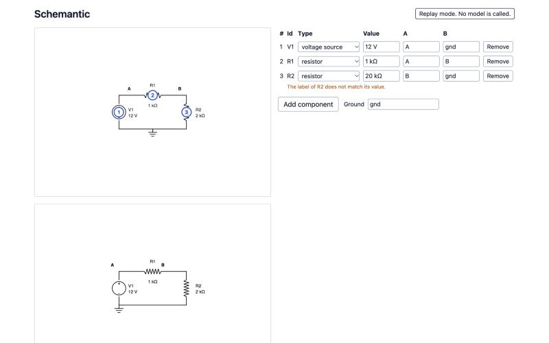
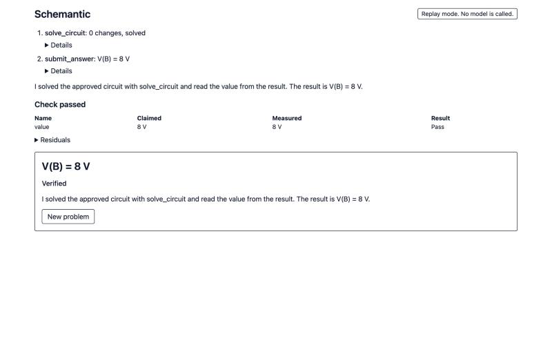

# Schemantic

Schemantic reads a photo of a circuit or a graph, turns it into structured data you can check and correct, and has a team of agents solve the problem with you, step by step.

Schemantic is a 2026 rebuild of NexusAgents, an earlier project of mine whose repository was lost.

## What it does

1. You upload an image of a DC circuit or a graph and type a question.
2. A **reader** agent (Claude with vision) converts the image into a typed structure: a netlist for a circuit, or axes, series and annotations for a graph.
3. You see the structure as an editable table, as numbered markers on your image, and as a schematic redrawn from it. You fix any misread and approve it.
4. A **solver** agent (Claude with tools) plans the solution. Deterministic code does the math: modified nodal analysis for circuits, interpolation and integration for graphs.
5. A **checker** verifies the answer against the approved data with element laws: Ohm's law, current balance at every node (KCL), power balance and units. An answer that fails is shown as not verified.
6. Every phase and token streams to the browser over WebSockets.

## Status

The core, the replay pipeline, the WebSocket server and the browser client work end to end. The reader and solver agents are built and tested against fakes; live mode waits for an API key. See [PLAN.md](PLAN.md) for milestones and the build guide in [docs/build](docs/build/README.md).

The core eval runs with no key: for all 18 problems (14 circuits, 4 graphs), the checker verifies the expected answer and rejects every wrong answer it is given (63 of 63).

```bash
npm run eval -- --core
```

## Run it

Replay mode plays recorded model responses for two sample circuits. It calls no model and needs no key.

```bash
npm install
npm run build:web
npm run dev:server
```

Then open http://localhost:8787, pick a sample, and press **Read image**.

To work on the client with hot reload, run the server and Vite in two terminals:

```bash
npm run dev:server
```

```bash
npm run dev:web
```

Then open the address Vite prints.

Each sample has one planted misread for you to catch in the review. In the voltage divider, R2's label and value disagree, and the review flags it. In the Thevenin sample, R2 is read as 1.2 kΩ where the image shows 12 kΩ; no rule can flag that, so you have to compare the table with the image. "Verified" means the answer is correct for the circuit you approved, so an uncorrected misread gives a verified answer to the wrong circuit.

| Review the reading | Checked answer |
|---|---|
|  |  |

## Stack

TypeScript end to end. Node with `ws` on the server. React, Tailwind and Vite on the client. The official `@anthropic-ai/sdk` with `claude-opus-5-5`, zod for structured outputs, and `mathjs` for the expression tool.

## License

MIT

## Layout

| Path | Contents |
|---|---|
| `src/core` | Schemas, unit parser, validator, MNA solver, graph tools, schematic renderer, checker. No model calls. |
| `src/pipeline` | Session state machine shared by the server, the tests and the in-browser demo. |
| `src/agents` | Anthropic client, reader agent, solver agent, scripted client for replay. |
| `src/server` | HTTP and WebSocket server. |
| `src/shared` | Message types shared by server and client. |
| `web` | React, Tailwind and Vite client. |
| `eval` | Problem set, image renderer, scoring, eval runner. |
| `fixtures` | Recorded model responses for replay mode. |
| `test` | Vitest tests. |


## Develop

```bash
npm install
npm run typecheck
npm test
npm run build:web
```
